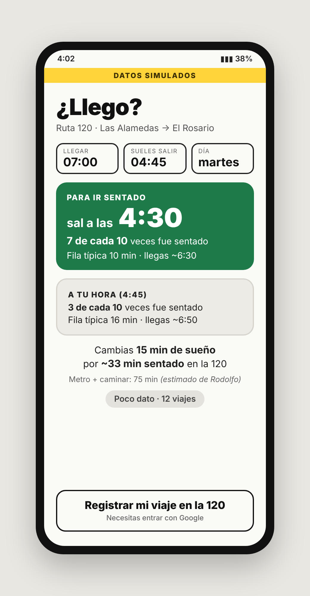
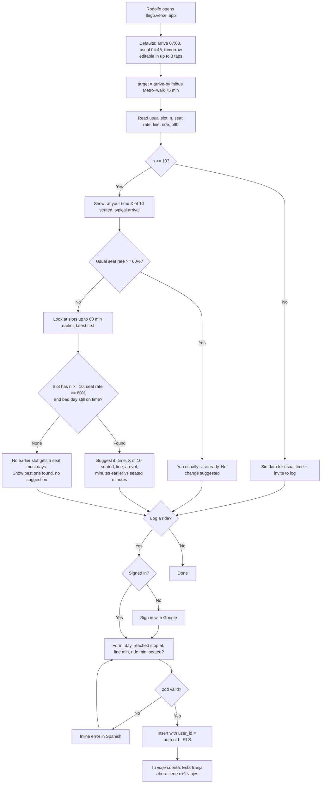
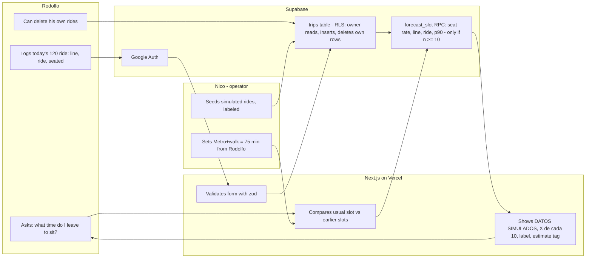

# ¿Llego? — Week 12 PACKET (Venture: charter + core build)

**Author:** Nicolas Martinez · **Venture:** ¿Llego? (from Week 7, Ch. 6 *The Holy Driver*) · **Week:** 12 of 17 · **Team:** T4
**Stack floor:** Next.js + Tailwind + Vercel + GitHub + Supabase (full free stack)
**Live URL (target):** `https://llego.vercel.app` (fallback `llego-mx.vercel.app` if taken)

> All trip data in this build is **SIMULATED and labeled on screen**. No real passengers, drivers, units or plates appear anywhere.

---

## 0. What changed, and why (the pivot inside the venture)

**Week 7** asked "how long will the colectivo take?" with map + ML + GPS + live reports. **The Week 11 Verdict** narrowed that to "what time do I leave?", on the hypothesis that Rodolfo wakes 3 hours early because of blind padding.

**Rodolfo's baseline (1 Nov 2026) killed that hypothesis.** He leaves at 4:45 and arrives at 6:45–6:50 for a 7:00 start, so his padding is 10–15 minutes and his "3 hours" is about 45 minutes getting ready plus 2 hours of real travel. A leave-by app could give him back 10–15 minutes at most, and on a 15-minute grid often nothing.

**His own words pointed somewhere else.** His complaint is the line and riding standing up, not the minutes. Asked *"¿Saldrías 15 minutos antes si supieras que vas sentado en la 120?"*, he said **yes** (1 Nov 2026). So the venture keeps its route, its data loop and its Shadow Clause, and changes the question:

> **"¿A qué hora salgo para ir sentado en la 120, y seguir llegando a las 7?"**

## 1. Problem (in my words)

Rodolfo starts at 7:00 at the Cámara de Diputados. His trip starts with the Ruta 120 bus from Las Alamedas to Metro El Rosario: a long line, then about 35 minutes standing, squeezed in. After that come three Metro lines, where he stands again. Nobody can tell him whether leaving 15 minutes earlier would get him a seat on the 120, because the route has no schedule, no feed and no crowding data anywhere. So every day he leaves at the same time and takes what comes.

In his words (Oct 2026): *"Me tengo que despertar tres horas antes para llegar al trabajo, hacer filas larguísimas para subir a un transporte que va lleno, viajar parado y apretado, aguantando el mal olor y la suciedad. Y al salir, todavía me espera todo el camino de regreso a casa."*

This product attacks **one piece** of that: the line and the standing on the 120. It does nothing for the Metro part, the smell or the trip home, and it says so.

## 2. Exact user

**Rodolfo**: a real person, a professional driver who commutes daily from Atizapán to San Lázaro. Consent given (1 Nov 2026) to use his quote, route and baseline in course deliverables.

**His route (confirmed by Rodolfo, Nov 2026):**

| # | Leg | Mode | In scope? |
|---|---|---|---|
| 1 | Walmart Las Alamedas (Atizapán) → Metro El Rosario | **Ruta 120 bus** | ✅ **This is what ¿Llego? measures** |
| 2 | El Rosario → Instituto del Petróleo | Metro L6 (dir. Martín Carrera) | ❌ |
| 3 | Instituto del Petróleo → Pantitlán | Metro L5 (dir. Pantitlán) | ❌ |
| 4 | Pantitlán → Candelaria | Metro L1 (dir. Observatorio) | ❌ |
| 5 | Candelaria → Palacio Legislativo de San Lázaro | Walk | ❌ |

**Baseline (dated 1 Nov 2026, from Rodolfo):**

| | Value |
|---|---|
| Wakes up | 4:00 |
| Leaves home | **4:45** |
| Arrives at work | **6:45–6:50** (starts 7:00) |
| El Rosario → Cámara (legs 2–5) | ~75 min (his estimate) |
| Ruta 120 leg incl. line | ~45–50 min (derived: 120–125 total − 75) |
| Would leave 15 min earlier to ride seated | **Yes** |
| How often he sits today at 4:45 | **Unknown.** His first logged week measures it |

- **When it hurts:** at the 120 stop (the line) and on board (standing).
- **Device:** Android, WhatsApp-native. Mobile web, no install.

## 3. Success definition

> **Before the module closes:** Rodolfo opens the live URL and, with his defaults already filled in (arrive by 07:00, he usually leaves at 04:45, tomorrow), sees in **0–3 taps** what his chances of a seat on the 120 are at his usual time, the latest departure that gets him a seat most days while still arriving on time, and what that costs him in minutes of sleep. All of it comes with a confidence label and the number of rides behind it. If he signs in with Google, he can log today's ride (line minutes, ride minutes, seated yes/no) in under 30 seconds.

Measurable:
- The answer appears on load with the defaults; changing any input takes ≤ 3 taps.
- Seat chances are shown as **"X de cada 10 veces fue sentado"**, never as a promise.
- A suggested time is only offered if, on a bad day (p90), he still reaches El Rosario in time to arrive by the arrive-by time.
- Labels: **Buen dato** (n ≥ 30) · **Poco dato** (10–29) · **Sin dato** (< 10: nothing slot-level shown).
- The Metro + walk time (75 min) shows as **"estimado de Rodolfo"**, not measured.
- A logged ride is visible only to its owner (RLS), can be deleted by its owner, and is only ever counted in aggregates.
- The `DATOS SIMULADOS` banner is visible whenever simulated rows feed the answer.

## 4. Mockup (image-generated)



**Prompt to regenerate in the course LLM Project:**
> Mobile web app screen, Spanish UI, high contrast, very large type for a tired commuter at 4am, Android phone frame. Top: thin yellow banner "DATOS SIMULADOS". Header "¿Llego?" with subtitle "Ruta 120 · Las Alamedas → El Rosario". A compact row of three small fields: "Llegar 07:00", "Sales 04:45", "martes". A big green card: "Para ir sentado: sal a las 4:30", and under it "7 de cada 10 veces fue sentado · fila típica 10 min · llegas ~6:30". Below it a grey card: "A tu hora (4:45): 3 de cada 10 · fila típica 16 min · llegas ~6:50". A line: "Cambias 15 min de sueño por ~33 min sentado en la 120". Small grey text: "Metro + caminar: 75 min (estimado de Rodolfo)". A small grey pill "Poco dato · 12 viajes". Bottom: a large outline button "Registrar mi viaje en la 120". Flat design, no map, no vehicle icons, no logos.

## 5. Flow

### 5a. How the feature works



### 5b. Who does what



## 6. Benchmark

**The best existing solution on Earth for this is** Google Maps' *transit crowdedness predictions*, which tell you whether your bus or train is "usually standing room only," based on anonymous rider reports, so you can decide to squeeze on or wait for an emptier one.

**Mine differs or localizes by** working on a route Google has no data for (the Ruta 120 has no schedule or feed), and by answering the decision Rodolfo actually makes. Instead of a crowding label for a trip he's already taking, it compares *his* usual departure with earlier ones and puts the trade in his terms: minutes of sleep against minutes seated, shown as "X out of 10 times" with the data count behind it.

## 7. Long view (light charter, 3 years)

If this slice works, ¿Llego? becomes the comfort-and-reliability layer for the bus and colectivo routes that feed the Metro across the Valle de México. Every first leg like the 120 would have a by-the-hour picture of lines, seats and bad days, built from riders' logged trips and published openly, so riders can trade a little sleep for a seat on purpose and operators can see exactly which departures need another unit. The load-bearing wall that never moves: **the data describes routes and hours, never workers.** No unit, plate or driver column exists, so the product can never become a tool for punishing the person behind the wheel.

## 8. Scope cut (NOT building this week)

- ❌ The Metro legs (no seat or time prediction there; 75 min fixed estimate, labeled).
- ❌ "What time do I leave" for time alone (killed by the baseline, §0).
- ❌ Map, GPS, background location, ML model. Aggregates in SQL only.
- ❌ Live "right now" reports, alerts, notifications, alarm integration.
- ❌ Other routes, route search, the return trip (he mentions it; second product).
- ❌ Any unit, plate, driver or operator field. Ever.
- ❌ Ride-hailing, booking, dispatch.
- ❌ Native app.

## 9. Architecture + stack

**Corridor:** Ruta 120, `Walmart Las Alamedas (Atizapán) → Metro El Rosario`, plus `restOfTripMin = 75` (Rodolfo's estimate) to the Cámara. Defaults `arriveBy = 07:00` and `usualDepart = 04:45` live in `src/config/corridor.ts`. The user can override them via query params; nothing about him is stored server-side.

| Layer | Choice (free tier) | Why |
|---|---|---|
| Frontend | Next.js 15 App Router + TypeScript + Tailwind | Course stack; server components keep queries off the client |
| Hosting | Vercel (Hobby), project name `llego` | Free subdomain under the venture's name |
| Repo | GitHub `llego` (public OK, no secrets) | 5+ commits, 2+ deploys |
| DB + Auth | Supabase Postgres + Auth (Google) | Security floor: auth + RLS |
| Forecast | Postgres function `forecast_slot()`: seat rate + `percentile_cont` | Explainable, no model to train |
| Validation | zod on every form + DB `check` constraints | Floor item 4, enforced twice |
| Secrets | Vercel env vars only (`NEXT_PUBLIC_SUPABASE_URL`, `NEXT_PUBLIC_SUPABASE_ANON_KEY`) | Floor item 1; no service-role key in the app |

**Data model** (one row = one ride on the 120)

```
trips
  id            uuid pk default gen_random_uuid()
  user_id       uuid null references auth.users  -- null only for simulated seed rows
  day_type      text check in ('laborable','sabado','domingo')
  depart_slot   time check (minute in 0,15,30,45)   -- 15-min bucket he reached the stop
  wait_min      int  check 0..180                   -- minutes in line
  ride_min      int  check 5..300                   -- minutes on board to El Rosario
  seated        bool not null
  is_simulated  bool not null default false
  created_at    timestamptz default now()
-- No unit, plate, driver, route-operator or location columns. By design.
```

- **RLS on `trips`:** `select` / `insert` / `delete` only where `user_id = auth.uid()`. Seed rows aren't readable by anyone through the API.
- **`forecast_slot(day_type, slot)`** is `security definer` and returns `n`, plus `seat_rate`, `p50_wait`, `p50_ride` and `p90_total`, all of which are null when n < 10. No row-level data leaves the database.

## 10. Blueprint conditions (Team 4, Week 12) → how this build honors them

> ⚠️ The Blueprint declared my bet as *"typical/bad travel times."* The baseline moved it to *seat on the 120*. **To ratify with the team** before submission.

| Condition | In this build |
|---|---|
| 1. Chapter uniqueness | W7 is mine; no collision (Blueprint confirms) |
| 2. Real user, dated task + baseline, consent | ✅ Rodolfo, 1 Nov 2026: route, departure 4:45, arrival 6:45–6:50, Metro ≈ 75 min, stated preference, consent |
| 3. One bounded loop + outside gate | One loop: check → decide → log. Corridor verified (Ruta 120). Outside gate: two weeks of Rodolfo's own real logs (below) |
| 4. 10:1 on the same task | Same task, same outcome on both sides: *ride the 120 to El Rosario and arrive by 7:00*, outcome = seated yes/no. See below |
| 5. Shadow Clause | No score, no automatic verdict: the app suggests, he decides. Sparse data shows as Sin dato; the Metro time is tagged as an unmeasured estimate; users can delete their rides; no driver/plate/vehicle field exists |

Blueprint risk *"sparse reports make p90 misleading"* → nothing slot-level is shown under n = 10.

### Condition 4, done honestly

- **Trade:** leave 15 minutes earlier ↔ ride the 120 seated (~33 min) instead of standing, still arriving before 7:00.
- **Evidence so far:** a **stated preference** (he said yes, 1 Nov 2026). That's a reason to build, not a result.
- **Test (outside gate):** week A, he leaves at 4:45 as usual and logs every ride, which gives the baseline seat rate. Week B, he leaves at the suggested time and logs again. Compare seated days out of 5, line minutes and arrival time.
- **Result rule, written before the data:** if week B gives ≥ 3 more seated days than week A and he never arrives after 7:00, the trade holds. If not, the seat hypothesis fails too, and I say so.
- **Not claimed:** the simulated "3 de cada 10 → 7 de cada 10" on the demo screen is invented to make the screen legible. It is labeled and it is not evidence.

## 11. Security floor (checked before building)

| Check | How |
|---|---|
| 🔑 No secrets in repo | `.env.local` in `.gitignore`; keys only in Vercel; only the anon key used client-side |
| 🔐 Auth for personal data | Logging rides requires Google sign-in. The forecast is anonymous aggregates only. Defaults live in config/query params, not in the DB |
| 🚪 RLS on | `trips` RLS enabled with owner-only policies; tested with two accounts |
| 🧹 Input validated | zod schema + DB `check` constraints; 15-min slots; bounded minutes; `seated` required |
| 🎭 No real data in demos | Seed is generated, `is_simulated = true`, banner on screen. Rodolfo's own rides stay behind RLS and never appear on a demo screen |

## 12. Test plan

**Mechanical pass**
1. Open the home page → the answer appears with the defaults; 360px wide, no horizontal scroll.
2. Defaults (07:00, 04:45, martes) → usual "3 de cada 10", suggestion **4:30** with "7 de cada 10", arrivals ~6:50 and ~6:30, "Cambias 15 min de sueño por ~33 min sentado", Poco dato · 12.
3. Usual 04:15 → "Ya sueles ir sentado a esa hora" (seat rate 0.8); no suggestion.
4. Arrive 06:00 → no slot is on time on a bad day → no suggestion, honest message.
5. Sábado or domingo → Sin dato; no slot-level numbers.
6. Log a ride signed out → Google sign-in, then back to the form.
7. `wait_min = -5`, `ride_min = 999`, seated left blank → rejected with Spanish errors; nothing inserted.
8. Log a ride → that slot's n goes up by 1; delete it → back.
9. Account B can't read account A's rides; the anonymous client can't `select` from `trips`.
10. `git grep -nE "service_role|sb_secret|eyJhbGci"` → nothing.

**Persona test (Layer 1)**: in a fresh chat, paste each screen in order:
> "Eres Rodolfo, chofer profesional. Vives en Atizapán y entras a las 7 en la Cámara de Diputados. Sales a las 4:45, tomas la ruta 120 en el Walmart de Las Alamedas hasta Metro El Rosario, haces fila larga y casi siempre vas parado; luego tres líneas de Metro. Usas WhatsApp todo el día pero no instalas apps. A las 4am estás cansado y no tienes paciencia. Si algo te pide cuenta o datos sin decirte para qué, lo cierras. Recorre estas pantallas e intenta decidir si mañana sales más temprano para ir sentado. Narra en voz alta dónde dudas, qué no entiendes y dónde lo cerrarías."

Log every confusion in `docs/PERSONA_LOG.md` and fix the worst one before the deadline.
