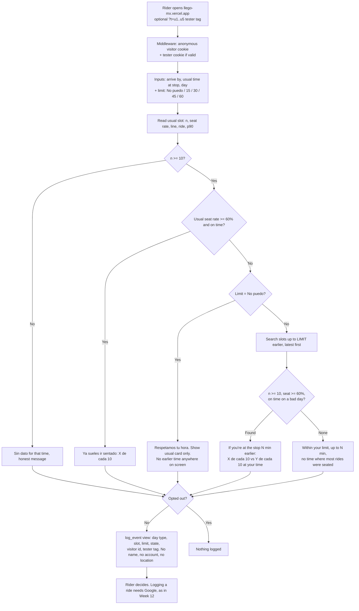
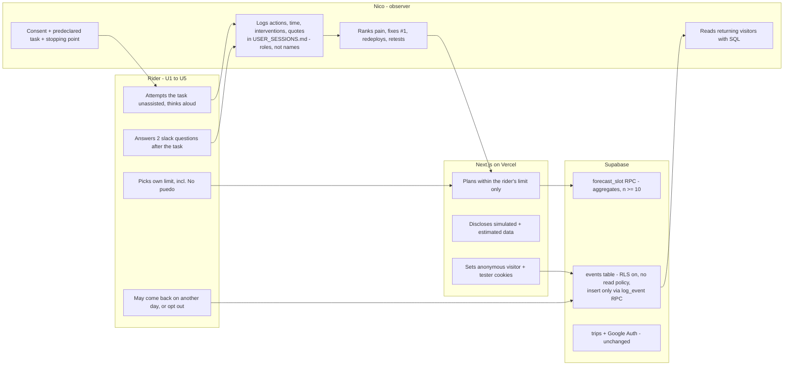

# ¿Llego? — Week 13 PACKET (Venture: real humans, five users who don't love you)

**Author:** Nicolas Martinez · **Venture:** ¿Llego? (from Week 7, Ch. 6 *The Holy Driver*) · **Week:** 13 of 17 · **Team:** T4 · **Lens this week:** User
**Stack floor:** Next.js + Tailwind + Vercel + GitHub + Supabase **+ an analytics/feedback mechanism (event log)**
**Live URL:** https://llego-mx.vercel.app · **Repo:** `NickosGit/Llego-mx`

> All trip data in this build is **SIMULATED and labeled on screen**. No real passengers, drivers, units or plates appear anywhere. Week 12's packet is in git history (`714c850`).

---

## 0. What changed, and why

**Week 12 bet:** "leave 15 minutes earlier and ride the 120 seated." It rested on one stated preference: Rodolfo said *yes* when asked if he'd leave 15 min earlier for a seat (1 Nov 2026).

**Rodolfo's follow-up (Nov 2026) took that back.** Leaving earlier costs him sleep: he goes to bed at 10 pm and gets up at 4:15. And he can't let a full bus pass to wait for the next one, because he'd be late to work. **His slack is zero in both directions.** For him, the Week 12 suggestion card is pressure to lose sleep, which is exactly what the Shadow Clause forbids.

**The Team 4 Blueprint (Week 13) turned that into my declaration:**

> **Nicolas → ¿Llego?:** honor each rider's chosen time limit, then test the slack hypothesis with four additional riders; disclose simulated or insufficient data. **Conditions 2, 4, 6.**

So this week does three things:
1. **The rider sets the limit.** The app asks how much earlier (if at all) the rider could be at the stop without it costing them, and never suggests anything past that. The default is **"No puedo antes"**.
2. **Real humans test it.** Rodolfo plus four other riders of the 120, at least three of them strangers. The four answer the slack question, which decides whether the seat idea survives at all.
3. **An event log** shows whether anyone comes back on their own.

## 1. Problem (in my words)

Riders of the Ruta 120 (Las Alamedas → Metro El Rosario) line up and ride standing, and nobody can tell them when the bus tends to have seats, because the route has no schedule, no feed and no crowding data. Week 12 answered "leave earlier and you'll sit." But the one real rider I have can't leave earlier, and a tool that only works by taking sleep from someone who has none to give isn't a product, it's a nudge. **The real open question is whether *any* meaningful share of 120 riders has slack to trade.** If not, the seat question dies on this corridor and I say so.

Rodolfo, in his words (Oct 2026): *"Me tengo que despertar tres horas antes para llegar al trabajo, hacer filas larguísimas para subir a un transporte que va lleno, viajar parado y apretado…"*

## 2. Exact user

**Primary:** a weekday rider of the Ruta 120 from Walmart Las Alamedas (Atizapán) to Metro El Rosario, on the way to a fixed start time in CDMX. Android, WhatsApp-native, opens links but doesn't install apps, uses the phone one-handed in a line before dawn.

**This week's five:**

| # | Who | Stranger? | Why them |
|---|---|---|---|
| U1 | **Rodolfo**, professional driver, 120 + 3 Metro lines to San Lázaro | ❌ No (friend of my dad) | Real baseline, consent on file, zero slack |
| U2–U5 | Four riders of the 120, recruited at the El Rosario paradero (evening line back to Atizapán) or the Las Alamedas stop | ✅ **at least 3 of 4** | Strangers, people this venture claims to serve |

Recorded by **role, never name** (e.g. "oficinista, 120 diario, entra 8:00").

## 3. Success definition

> **Before the module closes:** five real riders (≥ 3 strangers) have each tried one predeclared task on the live URL. Every session is logged with unassisted actions, time, interventions, misunderstandings and exact quotes. The three worst findings are ranked by consequence × recurrence. The #1 is fixed, redeployed and shown before/after. The event log shows at least one rider returning on a different day without being asked again. And the slack hypothesis has a written verdict.

Measurable:
- **Limit honored:** with "No puedo antes," no screen ever shows an earlier time. With "15 min," nothing earlier than 15 min appears. Unit-tested.
- **Disclosure:** the simulated banner says in plain Spanish what it means. Arrival says "al trabajo." The Metro time says "estimado, no medido," not a stranger's name.
- **Event log:** every home view and logged ride writes one anonymous row. Tester links (`?t=u1`…`?t=u5`) tag sessions. Nothing ties a row to a Google account, name or location. Opt-out works.
- **Slack verdict, written before the data (Blueprint bet):** the seat hypothesis survives on this corridor **only if ≥ 2 of the 4 other riders** (a) say they could be at the stop **15+ minutes earlier** without it costing them sleep or lateness **and** (b) have **already** waited or come early for a seat at least once. Otherwise it fails, and Week 14 starts from that.

## 4. Mockup (image-generated)


**Prompt to generate in the course LLM Project** (save as `docs/mockup-w13.png`):
> Mobile web app screen, Spanish UI, high contrast, very large type for a tired commuter at 4am, Android phone frame. Top: yellow banner "DATOS SIMULADOS" with a smaller line "Ejemplo inventado para probar la app. Aún no son viajes reales." Header "¿Llego?" with subtitle "Ruta 120 · Las Alamedas → El Rosario". A row of three small fields: "Llegar 07:00", "Sueles estar en la parada 04:45", "martes". Below, a question "¿Cuánto antes podrías estar en la parada sin que te cueste?" with five pill buttons: "No puedo" (selected, dark), "15 min", "30 min", "45 min", "1 h". A bordered card: "Respetamos tu hora. No te vamos a pedir salir antes." A grey card: "A tu hora (4:45): 3 de cada 10 veces fue sentado · fila típica 16 min · llegas al trabajo ~6:50". Small grey text: "Metro + caminar: 75 min (estimado, no medido)". A grey pill "Poco dato · 14 viajes". Tiny text at the bottom: "Contamos visitas sin nombre ni ubicación para saber si la app sirve · No contar las mías". Large outline button "Registrar mi viaje en la 120". Flat design, no map, no vehicle icons, no logos.

## 5. Flow

### 5a. How the feature works



### 5b. Who does what (swimlane)



## 6. Benchmark

**The best existing solution on Earth for this is** Google Maps' transit crowdedness predictions, which tell riders from anonymous reports whether a bus or train is usually crowded, so they can wait for an emptier one or leave at another time.

**Mine differs or localizes by** covering a route Google has no feed for (the Ruta 120), and by starting from the rider's own limit instead of assuming everyone can shift. If you say you can't leave earlier, it never tells you to, and it says plainly when the data is simulated or too thin.

## 7. Long view (light charter, 3 years)

If this slice works, ¿Llego? becomes the honest information layer for the buses and colectivos that feed the Metro across the Valle de México: by-the-hour lines, seats and bad days, built from riders' own logs and published openly. It serves both the riders who have slack to trade and the ones who don't, telling the second group what to expect rather than what to sacrifice. The load-bearing walls never move: **the data describes routes and hours, never workers**, and **the rider's limit beats the algorithm's suggestion.**

## 8. Scope cut (NOT building this week)

- ❌ "Wait for the next bus" (dejar pasar un camión). Rodolfo can't, and it needs live data I don't have.
- ❌ Any feature for zero-slack riders beyond showing their odds honestly. That's Week 14, *if* the slack verdict fails.
- ❌ Third-party analytics (GA, PostHog, Vercel Analytics). The event log is one Supabase table I fully control.
- ❌ Storing the rider's limit or times server-side: they stay in query params, as in Week 12.
- ❌ Metro legs, return trip, map, GPS, live reports, notifications, native app.
- ❌ Any unit, plate, driver or operator field. Ever.
- ❌ Collecting testers' names, phone numbers or WhatsApp in the repo or database.

## 9. Architecture + stack

| Layer | Choice (free tier) | Change this week |
|---|---|---|
| Frontend | Next.js 15 App Router + TypeScript + Tailwind | New limit input, `sin_margen` state, disclosure copy |
| Hosting | Vercel Hobby, project `llego-mx` | Two deploys: before sessions, after the #1 fix |
| DB + Auth | Supabase project `llego-mx` (Postgres + Google Auth) | New `events` table + `log_event` RPC |
| Forecast | `forecast_slot()` RPC | Unchanged |
| Analytics | **`events` table, first-party, anonymous** | **New: stack floor item** |
| Validation | zod + DB `check` constraints | Limit param, tester tag, event fields |
| Secrets | Vercel env vars only (URL + publishable key) | Unchanged; still no service-role key |

**Event log data model:**

```
events
  id          bigint identity pk
  visitor_id  uuid not null              -- random, from an httpOnly cookie; never linked to auth.users
  tester      text null check (tester ~ '^u[1-9]$')   -- session tag from ?t=, e.g. u3
  name        text not null check (name in ('view','ride_logged'))
  day_type    text null check (day_type in ('laborable','sabado','domingo'))
  slot        time null                  -- usual time at the stop
  limit_min   int  null check (limit_min in (0,15,30,45,60))
  state       text null check (state in ('sin_dato','ya_sentado','sin_margen','sugerencia','sin_sugerencia'))
  created_at  timestamptz not null default now()
-- No user_id, IP, user agent, location, name or phone. By design.
```

- **RLS on, zero policies:** nobody can select, update or delete through the API. Inserts only go through `log_event(...)`, a `security definer` function that validates every argument and is granted to `anon` and `authenticated`.
- **Reading it:** only from the Supabase SQL editor, with `supabase/queries/returning.sql` (visitors and tester tags seen on 2+ distinct days, plus the limit each one chose).
- **Opt-out:** `/no-contar` sets `llego_nocount=1`. With it set, nothing is logged.

## 10. Blueprint conditions (Team 4, Week 13) → how this build honors them

> ⚠️ The Blueprint is a document-based draft. Live dissent, the team vote and five-person results still need confirming in the meeting.

| Condition | In this build / these sessions |
|---|---|
| 1. Relevant outsiders, consent, predeclared task + stopping point, keep all outcomes | Riders of the 120, ≥ 3 strangers; spoken consent script; task and stop rule fixed in §12 before session 1; withdrawals and no-shows stay in `USER_SESSIONS.md` |
| **2. Unassisted actions, time, interventions, misunderstandings, consequential failures; praise isn't the outcome** | Session sheet records exactly these. "Le gustó" isn't a column. Each session ends with what the rider *decided*, not what they *felt* |
| 3. Like-for-like alternatives, full costs, 10:1 unproven until measured | Baseline = what riders do today (leave at their usual time, take what comes). Rider cost = minutes earlier at the stop, which is the very thing the slack question measures. **No 10:1 is claimed** |
| **4. Shadow Clause: no rider pressured to lose sleep, no disguised data** | Default limit "No puedo antes." Earlier times appear only inside the rider's own limit. The trade line is phrased as past odds, not a promise. Banner explains simulated data. The Metro time is labeled an unmeasured estimate |
| 5. Users control participation and personal info | Testers can stop at any time; no names or contacts stored; anonymous event log with an opt-out link on screen; rides still deletable |
| **6. Prioritize fixes by consequence × recurrence; retest high-risk misunderstandings** | `PAIN_RANKING.md` scores consequence (3 = decides wrong or arrives late, 2 = quits, 1 = friction) × riders affected. The #1 fix is retested with the persona and at least one real rider before it's called fixed |

**Dissent I carry into the meeting:** I agree with the provocation as written. If all five "liked it," I measured politeness. David qualifies it and Isidro doesn't treat praise as invalid. The proposed resolution (test behavior and consequences, not whether praise exists) works for me. My one-line case: **Rodolfo said "yes" in week 12 and then told me he can't. That yes was polite. The follow-up was the user.**

## 11. Security floor (checked before building)

| Check | How |
|---|---|
| 🔑 No secrets in repo | Unchanged: `.env.local` gitignored, only the publishable key, `git grep` before each deploy |
| 🔐 Auth for personal data | Ride logging still needs Google. The event log holds no personal data: random visitor id, no account link |
| 🚪 RLS on | `trips` unchanged (owner-only). `events`: RLS on with **no** policies; insert only via validated RPC; anon `select` returns 0 rows |
| 🧹 Input validated | zod on `limite` (0/15/30/45/60) and `t` (`u1`–`u9`), falling back to defaults; `log_event` re-checks everything; DB `check` constraints as a third line |
| 🎭 No real data in demos | Seed stays simulated + bannered. Session notes use roles, not names. No screenshots of a tester's face, phone number or account in the repo or demo |

## 12. Test plan

### 12a. Mechanical pass (before the sessions, on production)
1. Default load → limit "No puedo" selected → `sin_margen` card, **no earlier time anywhere**, usual card shows "3 de cada 10".
2. Limit 15, usual 04:45, martes → "Si estás en la parada 15 min antes: 7 de cada 10 … contra 3 de cada 10 a tu hora."
3. Limit 15, arrive 06:00 → message names "hasta 15 min antes," not "1 h."
4. Limit 60, usual 04:15 → `ya_sentado` regardless of limit.
5. `?limite=999&t=<script>` → falls back to No puedo, no tester tag, page renders.
6. Banner second line visible; "llegas al trabajo ~6:50"; "estimado, no medido."
7. Open `/?t=u3` → one `view` row with `tester = 'u3'` in SQL; reload → a second row with the same `visitor_id`.
8. `/no-contar`, then reload → no new rows.
9. Anon client: `select * from events` → 0 rows; direct `insert` → rejected; `log_event('hack', …)` → rejected.
10. Log a ride → one `ride_logged` row, with no `user_id` column anywhere in `events`.
11. Secrets grep → nothing outside `docs/`.

Find at least one bug, fix it, redeploy. Log in `docs/TEST_LOG.md`.

### 12b. Persona pass (Layer 1, quick, new screens only)
Fresh chat, same prompt as Week 12, but the persona is **a stranger**, not Rodolfo:
> "Eres una mujer de 34 años, cajera en una tienda en el centro, entras a las 8. Tomas la 120 en Las Alamedas hasta El Rosario y luego Metro. No conoces a nadie que se llame Rodolfo. Abres un link que te mandaron por WhatsApp a las 5 de la mañana en la fila. Recorre estas pantallas e intenta decidir si te conviene cambiar algo mañana. Narra dónde dudas y dónde lo cerrarías."

Log in `docs/PERSONA_LOG.md` (Week 13 section).

### 12c. Real users (Layer 2, the milestone)

**Consent (say it, mark it):** *"Estoy probando una página para la escuela sobre la ruta 120. No te pido tu nombre ni tu teléfono. Te voy a ver usarla y anotar lo que hagas y digas. Puedes parar cuando quieras. ¿Va?"*

**Predeclared task (same words for all five):** *"Mañana tienes que llegar a tu trabajo a tu hora de siempre. Con esta página, dime a qué hora tendrías que estar en la parada de la 120, y si cambiarías algo de lo que haces hoy."*

**Hand them:** their own phone + the link `llego-mx.vercel.app/?t=uN` (QR or typed). No explanation of the screen.

**Stopping point:** they say a time and whether they'd change anything, **or** 5 minutes pass, **or** they ask to stop. Whichever comes first.

**Record per session** (`docs/USER_SESSIONS.md`): role · stranger yes/no · where/when · time to answer · every intervention (and what I said) · each misunderstanding and the screen it was on · consequential failures (would decide wrong / arrive late) · what they decided · exact quotes · withdrawal if any.

**After the task, the two slack questions (not before, and not leading):**
1. *"Si supieras que a cierta hora casi siempre vas sentado, ¿cuántos minutos antes podrías estar en la parada sin que te cueste sueño ni llegar tarde?"*
2. *"¿Alguna vez has llegado antes o dejado pasar un camión para irte sentado?"*

**Come-back proof:** at the end: *"Si mañana te sirve, ábrela otra vez antes de salir."* Nothing more. Proof = the same tester tag or visitor id in `events` on a different day (`supabase/queries/returning.sql`). A message they send on their own also counts; screenshot it with the number hidden.

**Then:** rank the pain in `docs/PAIN_RANKING.md` → fix #1 → redeploy → before/after screenshots → retest with the persona plus at least one rider → write the slack verdict in DECISIONS.
